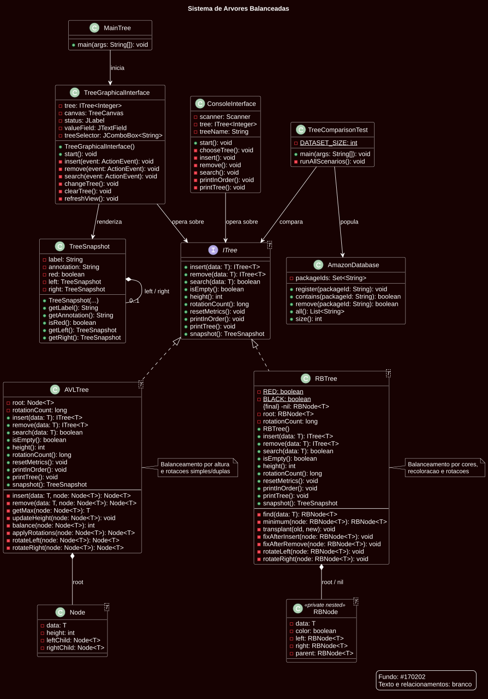
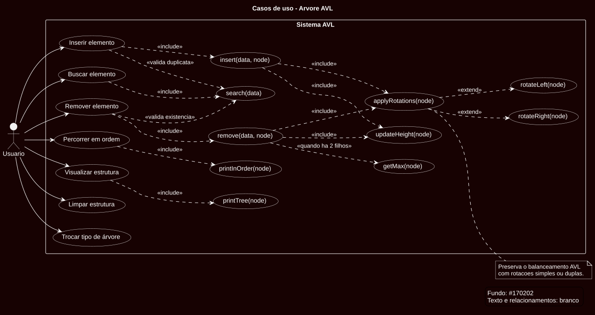
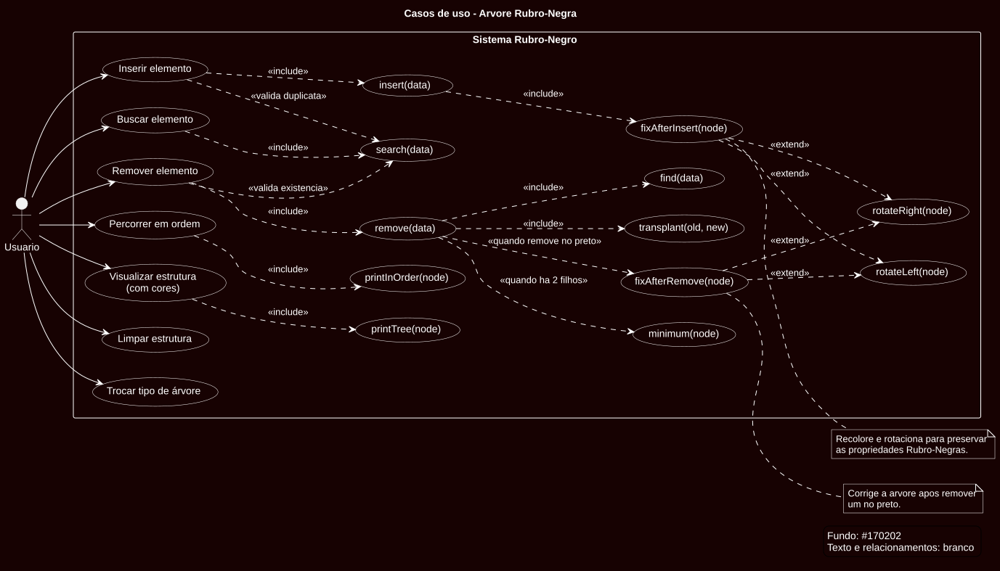

# Sistema de Árvores Balanceadas

> **Projeto de Estruturas de Dados — Árvores AVL e Rubro-Negra**

**Nome:** Thais Evelin Barbosa da Silva<br>
**Matrícula:** 20250039913

## Sobre o projeto

Este projeto implementa e compara duas estruturas de árvore de busca
balanceadas: a **árvore AVL** e a **árvore Rubro-Negra**. A aplicação simula o
armazenamento de identificadores de encomendas, permitindo inserir, remover,
buscar e visualizar os elementos por meio de uma interface gráfica Swing ou
de uma interface de console.

Além das operações fundamentais, o projeto acompanha a altura das árvores e a
quantidade de rotações realizadas. Esses indicadores ajudam a observar, na
prática, como cada estratégia de balanceamento se comporta em diferentes
cenários de entrada. A AVL prioriza um balanceamento mais rigoroso, enquanto a
Rubro-Negra oferece uma alternativa eficiente para cargas com muitas
atualizações.

### Implementação

- **AVL:** recalcula as alturas dos nós e utiliza rotações simples ou duplas
  para preservar o fator de balanceamento.
- **Rubro-Negra:** utiliza cores, um nó sentinela preto e os casos clássicos de
  recolorização e rotação após inserções e remoções.
- **Interfaces:** a interface gráfica permite alternar entre as estruturas e
  acompanhar sua representação visual; a interface de console disponibiliza
  as mesmas operações em modo textual.
- **Análise:** `TreeComparisonTest` executa cenários controlados e compara
  altura e rotações, enquanto `AmazonDatabase` fornece um banco de dados falso
  em memória para a simulação de encomendas.

O programa permite escolher, na inicialização, entre uma árvore AVL e uma
árvore Rubro-Negra. Ambas oferecem inserção, remoção, busca, percurso em ordem
e impressão da estrutura.

As duas implementações ignoram valores repetidos, preservando um único nó por
valor. A remoção e a busca de valores inexistentes não alteram a árvore e
informam essa situação ao usuário. Essas decisões evitam ambiguidades no
percurso e mantêm a propriedade de árvore de busca binária.

A AVL recalcula alturas e aplica rotações simples ou duplas após inserções e
remoções. A Rubro-Negra usa um nó sentinela preto e os casos clássicos de
recolorização e rotação para inserção e remoção; a impressão identifica cada
nó como `Vermelho` ou `Preto`.

## Como executar

Pré-requisitos:

- Java JDK instalado e disponível no `PATH`.
- Arquivo `lib\lombok.jar` presente no projeto.

Abra o PowerShell na pasta raiz do projeto e compile os arquivos:

```powershell
javac -cp "lib/lombok.jar" -processorpath "lib/lombok.jar" -d bin *.java
```

>obs.: É necessário criar uma pasta com o nome "/bin".

Depois, inicie a interface gráfica:

```powershell
java -cp "bin:lib/lombok.jar" MainTree
```

`MainTree` inicia a interface gráfica Swing implementada em
`TreeGraphicalInterface`. A interface permite trocar entre AVL e Rubro-Negra,
inserir, remover, buscar e limpar valores, além de visualizar a estrutura
balanceada com nós e conexões. Na visualização AVL, a altura aparece de forma
discreta acima de cada nó, no formato `h: x`.

Para executar a interface de console, use:

```powershell
java -cp "bin:lib/lombok.jar" ConsoleInterface
```

## Testes e análise comparativa

O arquivo [AmazonDatabase.java](./AmazonDatabase.java) implementa um
banco falso em memória para reproduzir a chegada, localização e remoção de
identificadores de encomendas. A classe
[TreeComparisonTest.java](./TreeComparisonTest.java) executa quatro cenários:
inserção crescente, inserção decrescente, ordem aleatória com `seed` fixa e
carga crescente com remoção dos identificadores pares.

Compile e execute os testes no PowerShell:

```powershell
javac -cp "lib/lombok.jar" -processorpath "lib/lombok.jar" -d bin *.java
java -cp "bin:lib/lombok.jar" TreeComparisonTest
```

Cada cenário valida que todos os identificadores foram localizados, que os
removidos deixaram de existir, discrimina o tamanho do banco lido e imprime a altura final e o número de rotações
de cada árvore. A altura é um indicador do custo esperado de busca; as
rotações representam o trabalho de rebalanceamento contabilizado pelo
programa.

Além da tabela, o programa imprime um gráfico ASCII no terminal. Cada `#`
representa uma proporção do maior valor do cenário para facilitar a comparação
visual entre altura e rotações.

Na execução de referência com 10.000 identificadores, os resultados observados
foram:

| Cenário | AVL (altura/rotações) | Rubro-Negra (altura/rotações) |
| --- | ---: | ---: |
| Crescente | 14 / 9.985 | 24 / 9.975 |
| Decrescente | 14 / 14.484 | 24 / 14.474 |
| Aleatório (`seed 39`) | 16 / 6.929 | 17 / 5.907 |
| Misto, removendo pares | 13 / 9.993 | 13 / 9.986 |

O teste está configurado atualmente para executar com **1.000.000 de
identificadores por cenário**. A tabela acima é mantida como referência
reprodutível da execução anterior; os novos números devem ser obtidos
executando o programa, pois dependem do volume efetivamente processado e do
ambiente disponível.

Todos os cenários terminaram com `OK`; o cenário misto terminou com 500.000
identificadores, e os demais com 1.000.000. Os números de rotação são acumulados
durante inserções e remoções do cenário.

A recomendação para o cenário investigado é a AVL quando a prioridade é
localizar encomendas com alta frequência: sua restrição de balanceamento é
mais forte e normalmente produz menor altura. A Rubro-Negra é uma alternativa
adequada quando a carga tem muitas atualizações e se deseja reduzir o custo de
rebalanceamento, pois aceita uma altura um pouco maior em troca de menos
rotações. A decisão final deve considerar os números impressos pela execução,
sem usar o tempo de uma única execução como critério isolado.

Na interface gráfica, use o campo `Valor` e os botões `Inserir`, `Remover` e
`Buscar`. O seletor `Tipo` permite alternar entre AVL e Rubro-Negra; a troca
cria uma nova árvore vazia. Na interface de console, a opção 6 também permite
trocar entre as duas estruturas. Os valores da estrutura anterior não são
copiados, evitando misturar estados de implementações diferentes.

O diagrama UML do projeto está disponível no arquivo-fonte
[projeto.puml](./projeto.puml) e na versão renderizada
.

Os casos de uso de cada implementação estão nos arquivos-fonte
[casos-uso-avl.puml](./casos-uso-avl.puml) e
[casos-uso-rubro-negra.puml](./casos-uso-rubro-negra.puml), e também nas versões
renderizadas:

**Diagrama de casos de uso — AVL**


**Diagrama de casos de uso — Rubro-Negra**


Os diagramas apresentam as operações da interface e os métodos internos de
balanceamento de cada estrutura.

## Contribuição do Copilot

O Copilot contribuiu como assistente no desenvolvimento e na organização da
implementação. Seu apoio foi utilizado para:

- auxiliar na integração das interfaces gráfica e de console;
- apoiar a criação dos testes comparativos e da simulação do banco de dados;
- organizar a documentação do projeto e os diagramas UML;
- revisar a clareza do código e identificar pontos de melhoria.

As decisões finais, a revisão do código e a validação do comportamento da
aplicação foram realizadas pela autora, mantendo a responsabilidade pela
implementação e pelos resultados apresentados.

## Ferramentas Utilizadas

- **Java 21**, linguagem de programação.
- **Project Lombok**, biblioteca que reduz código repetitivo (boilerplate), gerando automaticamente métodos como getters, setters e construtores por meio de anotações

## Referências

- CORMEN, T. H. et al. **Algoritmos: Teoria e Prática**. 3. ed. Rio de
  Janeiro: Elsevier, 2012.
- PROJECT LOMBOK. **Project Lombok**. Disponível em: https://projectlombok.org/. Acesso em: 27 out. 2026.
- ZIVIANI, N. **Projeto de Algoritmos com implementações em Java e C++**. São
  Paulo: Thomson Learning, 2007.
